<p align="center">
<b>Université Cheikh Anta Diop</b><br><br>
<b>Ecole Supérieur Polytechnique</b><br><br>
<b>Département Génie informatique</b><br><br>
<b>Année Universitaire 2026-2027</b><br><br>
<b>Licence 3 en Génie Logiciel et Système d’Information (L3 GLSI-A)</b><br><br>
<b>Étudiante : Sokhna Aicha KA</b><br><br>
<b>Cours : Services Réseaux avancés, Dr Keba GUEYE</b><br><br>
<b>Rapport de TP : Mise en place du protocole SSH</b>
</p>

---

## Introduction

Ce TP a pour objectif de comprendre comment utiliser le protocole SSH (Secure Shell) pour sécuriser l’accès à une machine distante. SSH établit un canal chiffré entre un client et un serveur : les identifiants et les données échangées sont protégés contre l’écoute du réseau, contrairement à des protocoles comme Telnet ou FTP qui transmettent les informations en clair.

Le travail est organisé en quatre parties :

- **A.** l’installation et la vérification du serveur OpenSSH ;
- **B.** la connexion SSH d’un client vers le serveur ;
- **C.** la configuration de l’authentification par clés ;
- **D.** la mise en place d’un tunnel SSH pour accéder à un serveur web et à une base de données.

## 2. Environnement de travail

Une seule machine virtuelle était disponible. Elle a donc été utilisée comme serveur SSH, et la machine physique sous Windows comme client. Les deux machines sont sur le même réseau local, la machine virtuelle étant configurée en accès par pont (bridge) afin d’obtenir une adresse IP du réseau local.

| Machine | Rôle | Système | Adresse IP |
|---|---|---|---|
| Machine virtuelle | Serveur SSH | Ubuntu 26.04.1 LTS | 192.168.1.15 |
| Machine physique | Client SSH | Windows (PowerShell, client OpenSSH intégré) | 192.168.1.14 |

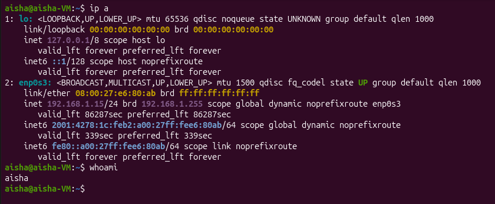

Utilisateur sur le serveur : `aisha`. Avant de commencer, la connectivité entre les deux machines a été vérifiée avec la commande `ping` depuis Windows : 4 paquets envoyés, 4 reçus, aucune perte.

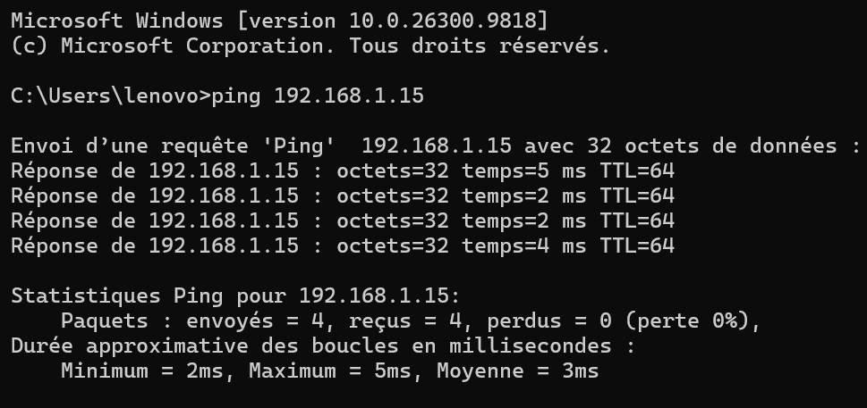

## 3. Étape 1 : Installation du serveur SSH

Sur la machine Ubuntu (serveur), le paquet `openssh-server` a été installé, puis le service a été activé au démarrage et lancé :

### 3.1 Vérification de l’installation

```bash
apt policy openssh-server
```

Cette commande indique la version installée du paquet `openssh-server`.

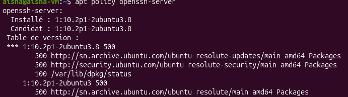

### 3.2 Vérification de l’état du service

Le service doit apparaître à l’état `active (running)` et écouter sur le port 22.

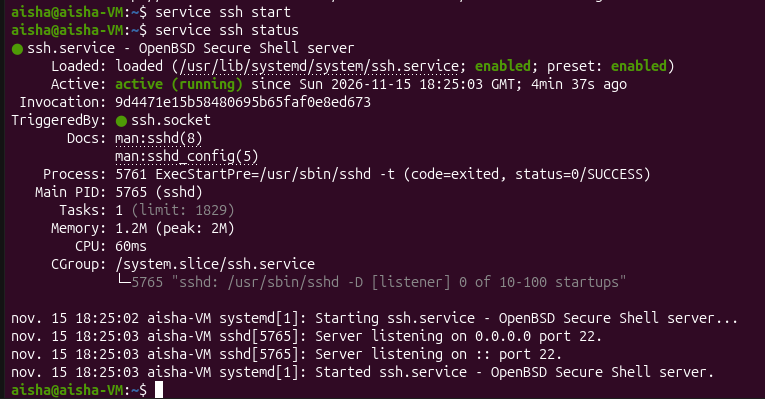

### 3.3 Vérification que le port 22 est ouvert

La commande `netstat` n’étant pas installée par défaut sur une Ubuntu récente, le paquet `net-tools` a d’abord été installé :

```bash
sudo apt install net-tools
sudo netstat -anp | grep -w 22
```

Le résultat montre le processus `sshd` à l’état `LISTEN` sur le port 22, en IPv4 (`0.0.0.0:22`) et en IPv6 (`:::22`), ce qui confirme que le serveur accepte les connexions SSH.

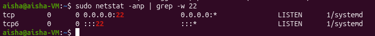

## 4. Étape 2 : Connexion SSH depuis le client

Depuis la machine Windows, la connexion est réalisée dans PowerShell avec la commande suivante :

```powershell
ssh aisha@192.168.1.15
```

Lors de la première connexion, le client affiche l’empreinte (fingerprint) de la clé du serveur et demande de confirmer son authenticité. Après confirmation (réponse `yes`), la clé du serveur est enregistrée dans le fichier `known_hosts` du client : lors des connexions suivantes, le client pourra détecter un changement de serveur. Le mot de passe de l’utilisateur `aisha` est ensuite saisi (il ne s’affiche pas à la saisie).

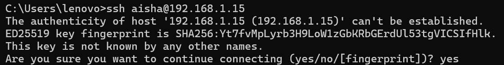

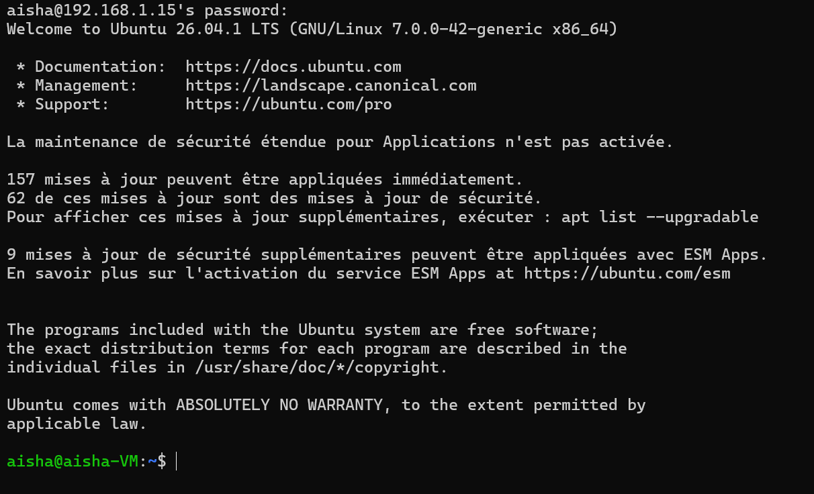

Pour confirmer que la session s’exécute bien sur le serveur, les commandes `whoami` et `hostname` ont été lancées, puis `exit` pour fermer la session.

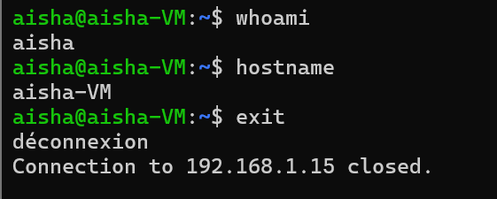

## 5. Étape 3 : Configuration des clés SSH

### 5.1 Génération d’une paire de clés sur le serveur

Conformément à la fiche de TP, une paire de clés RSA a été générée sur la machine serveur :

```bash
ssh-keygen -t rsa
```

L’emplacement par défaut a été accepté et la passphrase laissée vide. La commande crée deux fichiers dans le dossier `~/.ssh` : `id_rsa` (clé privée) et `id_rsa.pub` (clé publique).

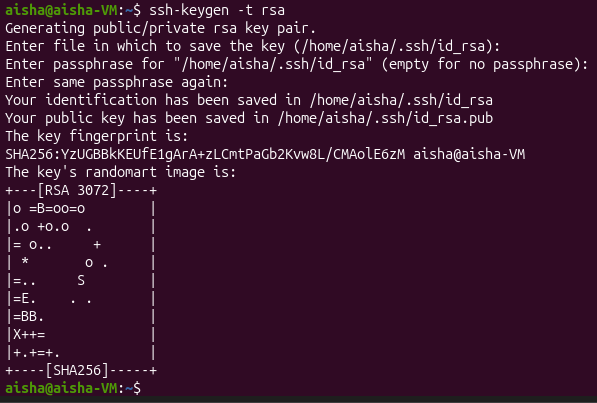

```bash
ls -a
cd .ssh
ls
```

Ces commandes permettent de vérifier la présence du dossier `.ssh` et des fichiers `id_rsa` et `id_rsa.pub`.

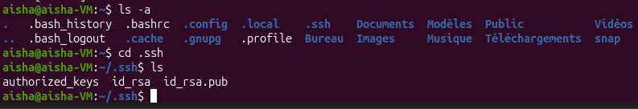

### 5.2 Authentification par clé depuis le client

**Principe.** L’authentification par clé repose sur la cryptographie asymétrique : le client prouve son identité grâce à sa clé privée, qui ne quitte jamais sa machine, et le serveur vérifie cette preuve avec la clé publique correspondante, enregistrée dans le fichier `~/.ssh/authorized_keys` de l’utilisateur cible. La clé privée reste donc chez celui qui se connecte, et la clé publique est placée chez celui qui vérifie.

**Adaptation à l’environnement de travail.** La fiche décrit l’envoi de la clé publique du serveur vers un client Linux. Dans cet environnement, le client est la machine Windows et le serveur est la machine virtuelle. Pour que la connexion sans mot de passe fonctionne réellement, le même principe a donc été appliqué dans le sens client vers serveur : la commande `scp` de la fiche a été conservée pour copier la clé, mais en envoyant la clé publique du client vers le serveur, puis en l’enregistrant dans `authorized_keys`.

Les opérations réalisées sont les suivantes.

**Étape a :** génération d’une paire de clés ed25519 sur le client Windows (PowerShell) :

```powershell
ssh-keygen -t ed25519
```

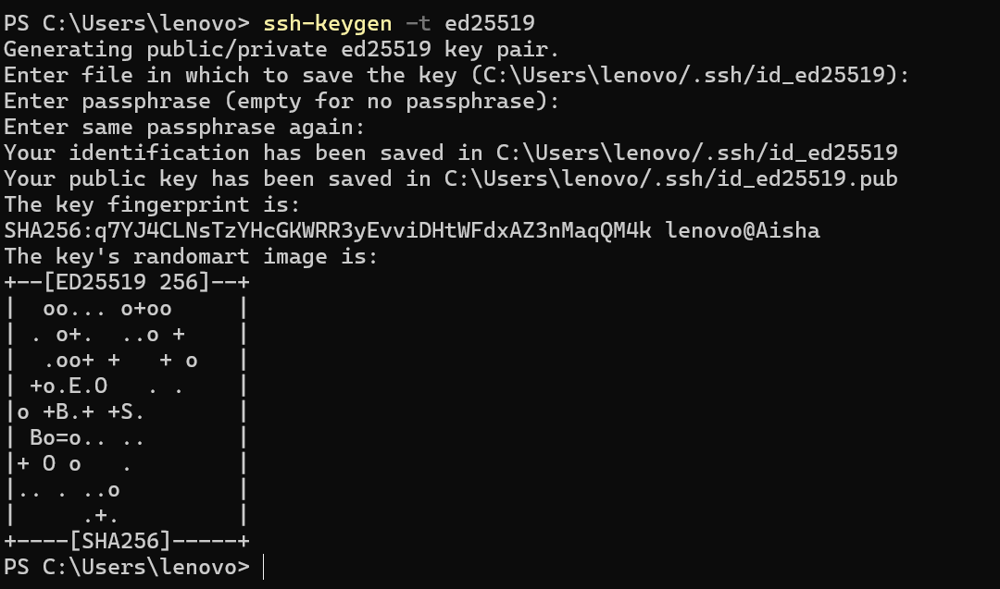

**Étape b :** envoi de la clé publique vers le serveur avec `scp` :

```powershell
scp $env:USERPROFILE\.ssh\id_ed25519.pub aisha@192.168.1.15:/home/aisha
```

Le mot de passe est demandé une dernière fois. Le transfert indique 100 %.

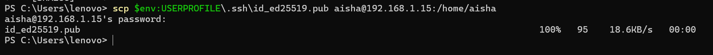

**Étape c :** sur le serveur, vérification de la présence de la clé puis enregistrement dans `authorized_keys` avec les droits adaptés :

```bash
ls ~
mkdir -p ~/.ssh
cat ~/id_ed25519.pub >> ~/.ssh/authorized_keys
chmod 700 ~/.ssh
chmod 600 ~/.ssh/authorized_keys
```

Les droits 700 sur `~/.ssh` et 600 sur `authorized_keys` sont nécessaires : si ces fichiers sont accessibles à d’autres utilisateurs, le serveur SSH refuse d’utiliser la clé.


**Étape d :** test de connexion depuis Windows :

```powershell
ssh aisha@192.168.1.15
```

Le serveur ne demande plus de mot de passe : l’authentification par clé fonctionne.

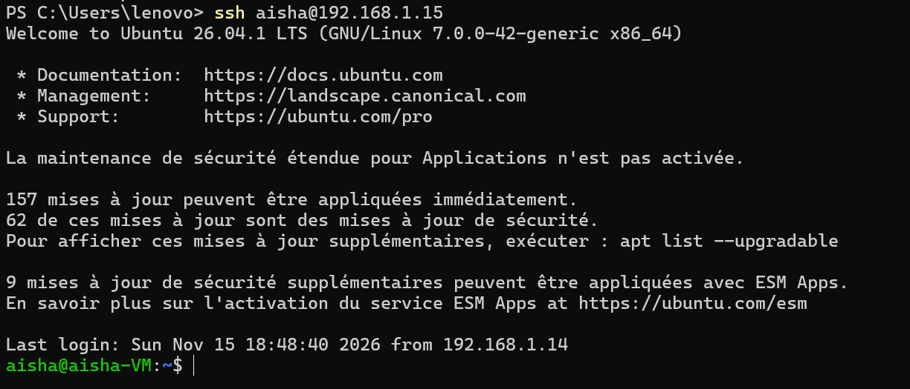

**Justification.** Une clé publique simplement copiée dans le dossier `/home` d’une machine n’est pas utilisée par SSH pour authentifier : le serveur ne consulte que le fichier `authorized_keys` de l’utilisateur. Le sens de la copie a donc été choisi pour que l’authentification soit effective avec les deux machines utilisées.

## 6. Étape 4 : Tunnel SSH en ligne de commande

Un tunnel SSH permet de faire transiter d’autres protocoles (HTTP, FTP, MySQL…) à l’intérieur d’une connexion SSH chiffrée, à travers un seul port autorisé (le port 22). Le client ouvre un port local, et tout le trafic envoyé sur ce port est redirigé, à travers le tunnel, vers un service accessible depuis le serveur. L’option utilisée est `-L` (redirection de port local) :

```bash
ssh -L port_local:adresse_cible:port_cible utilisateur@serveur
```

### 6.1 Test avec un serveur web (Apache)

Sur le serveur, Apache a été installé et son état vérifié :

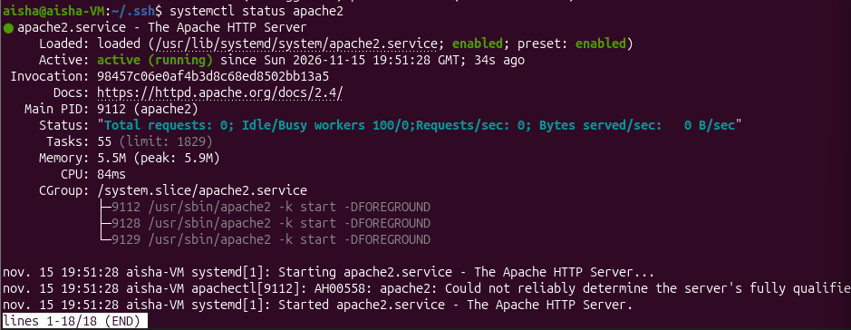

Depuis Windows, le tunnel suivant a ensuite été créé :

```powershell
ssh -L 1024:127.0.0.1:80 aisha@192.168.1.15
```

Cette commande redirige le port 1024 de la machine Windows, à travers le tunnel chiffré, vers le port 80 (HTTP) de la machine serveur, vu depuis le serveur lui-même (127.0.0.1). La session SSH doit rester ouverte : le tunnel n’existe que tant qu’elle est active.

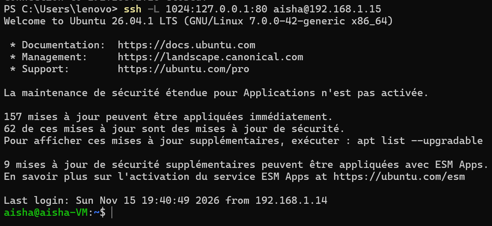

Dans le navigateur de la machine Windows, l’adresse `http://localhost:1024` est ouverte. La page par défaut d’Apache s’affiche, ce qui prouve que le trafic passe bien par le tunnel.

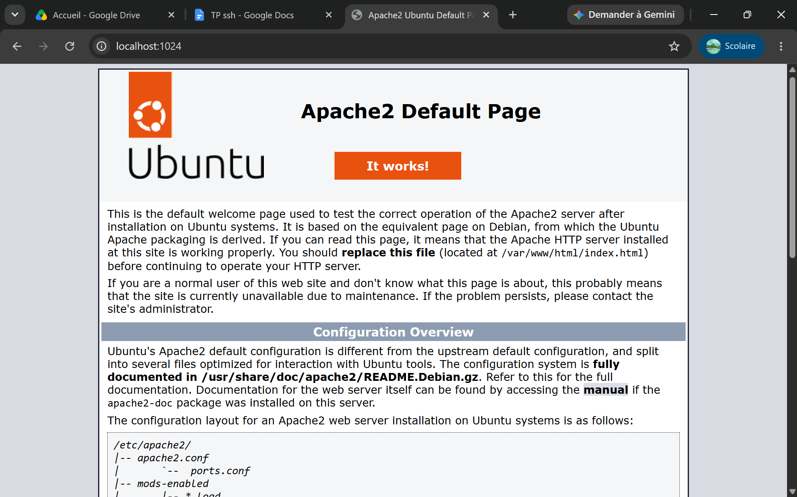

Pour vérifier que l’accès passe réellement par le tunnel, la session SSH a été fermée et la page rechargée : elle n’est plus accessible.

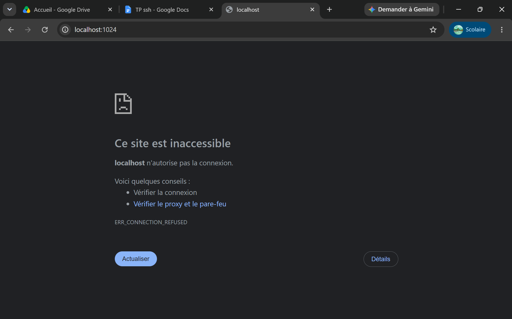

### 6.2 Test avec une base de données (MariaDB)

Sur le serveur, MariaDB a été installé, puis une base de test et un utilisateur dédié ont été créés :

```bash
sudo apt install mariadb-server
sudo mariadb
```

```sql
CREATE DATABASE tpdb;
CREATE USER 'tpuser'@'localhost' IDENTIFIED BY 'MotDePasse123';
GRANT ALL ON tpdb.* TO 'tpuser'@'localhost';
FLUSH PRIVILEGES;
EXIT;
```

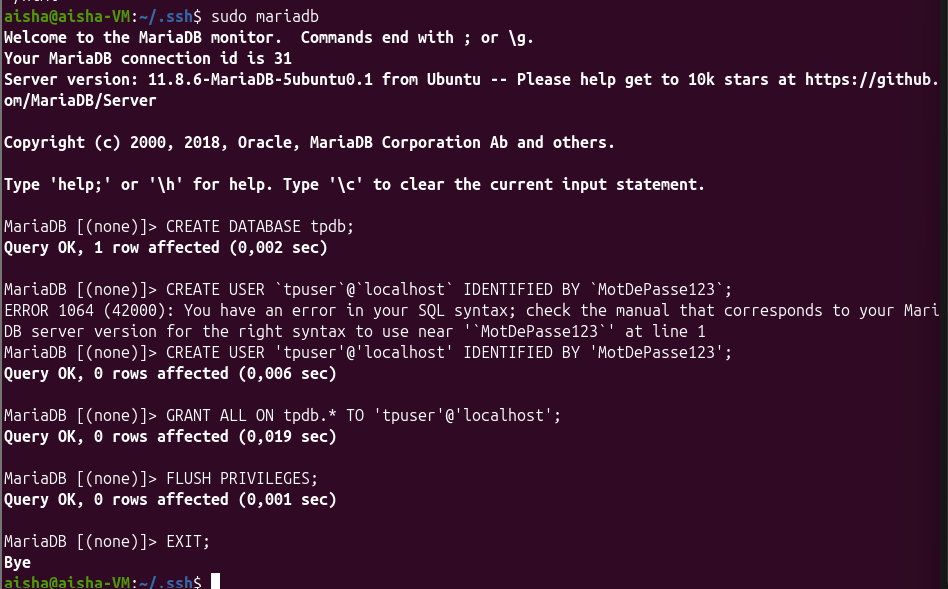

Depuis Windows, un tunnel vers le port 3306 de MariaDB a été créé, avec le port local 3307 :

```powershell
ssh -L 3307:127.0.0.1:3306 aisha@192.168.1.15
```

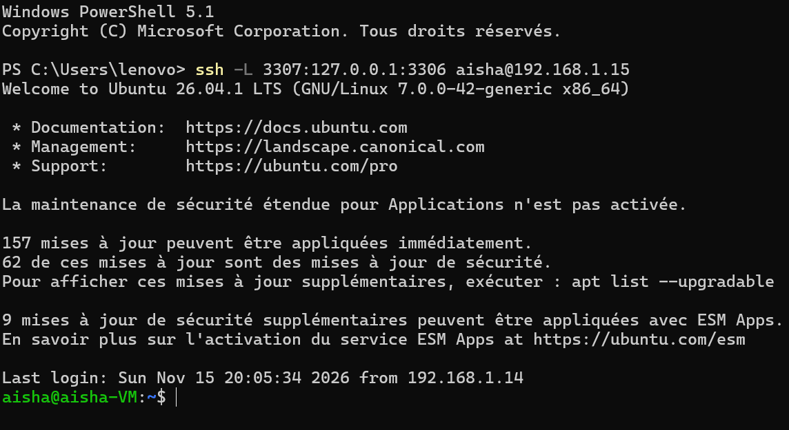

Aucun client SQL n’étant installé sur la machine cliente, la connexion a été testée avec un court script Python utilisant la bibliothèque PyMySQL (installée avec `pip install pymysql`). Le script se connecte à `127.0.0.1` sur le port 3307, c’est-à-dire à l’entrée du tunnel, et liste les bases de données :

```python
import pymysql

c = pymysql.connect(host="127.0.0.1", port=3307,
                    user="tpuser", password="MotDePasse123",
                    database="tpdb")
cur = c.cursor()
cur.execute("SHOW DATABASES")
print(cur.fetchall())
c.close()
```

Résultat obtenu avec `python test_db.py` :

```
PS C:\Users\lenovo> python test_db.py
(('information_schema',), ('tpdb',))
PS C:\Users\lenovo>
```

La base `tpdb` est bien listée : la machine Windows accède à la base MariaDB du serveur uniquement à travers le tunnel SSH, sans que le port 3306 soit exposé directement sur le réseau.

## 7. Difficultés rencontrées et solutions

- **Commande `netstat` absente :** sur une Ubuntu récente, `netstat` n’est pas installé par défaut. Solution : installer le paquet `net-tools` (la commande `ss`, plus moderne, donne le même résultat).
- **Une seule machine virtuelle :** la fiche suppose deux machines Linux. La machine physique Windows a été utilisée comme client et la machine virtuelle comme serveur.
- **Sens de la copie de la clé publique :** pour que la connexion sans mot de passe fonctionne, la clé publique doit être enregistrée dans `authorized_keys` du serveur. La procédure a été adaptée en conséquence (voir 5.2).
- **Tunnel à garder ouvert :** le tunnel SSH n’existe que tant que la session reste ouverte. Les tests doivent donc être lancés depuis une seconde fenêtre PowerShell.
- **Client SQL non disponible :** l’accès à la base de données a été validé avec un script Python (PyMySQL).

## 8. Conclusion

Ce TP a permis de mettre en place un serveur SSH et d’en comprendre les principaux usages. La connexion distante est chiffrée, l’authentification par clés évite la saisie répétée du mot de passe et renforce la sécurité, et les tunnels SSH permettent de protéger des services qui ne chiffrent pas leurs échanges, comme HTTP ou une base de données, en ne les exposant que via le port 22.